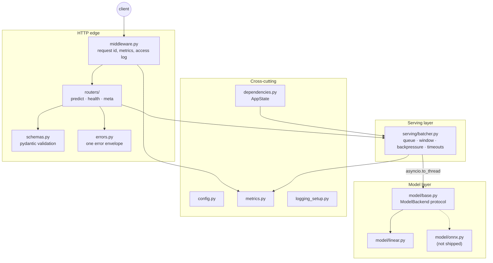

# Architecture

## The problem this solves

A model serving API looks like a CRUD API and is not one. The difference is
entirely in what happens **between the HTTP handler and the model**:

- Inference has a large fixed cost per call and a small marginal cost per item,
  so serving one request per forward pass wastes most of your hardware.
- Inference is CPU/GPU-bound and synchronous, so calling it naively on an event
  loop blocks every other request including health checks.
- Load arrives in bursts, so an unbounded queue converts a brief spike into an
  OOM kill.
- Models take seconds to load, so startup and shutdown ordering determines
  whether a deploy loses requests.

This repository is about that layer.

## Components



Request path:

```
POST /v1/predict
  |
  ObservabilityMiddleware   assign request id, start timer, count in-flight
  |
  Pydantic validation       reject bad input BEFORE it consumes capacity
  |
  require_api_key           constant-time comparison
  |
  get_batcher               503 if not ready, or if draining
  |
  batcher.predict(text)
        |
        +-- enqueue (bounded)  -> QueueFull  -> 503 + Retry-After
        +-- await future       -> Timeout    -> 504
        |
        [worker] collect batch -> asyncio.to_thread(model.predict_batch)
        |                         resolve every future positionally
        v
  PredictResponse + X-Request-ID
```

## The five decisions that shaped this

### 1. Batch as the primitive, not single prediction

`ModelBackend.predict_batch()` is the only inference method. Single prediction
is the degenerate case of a batch of one.

If the interface were `predict(text)`, batching would have to be bolted on later
around a fundamentally per-item contract, and a backend that can genuinely
vectorise (ONNX, PyTorch) would have no way to express it. Making the batch
primitive means adding a vectorised backend requires no change to the serving
layer at all.

### 2. The batch window is measured from batch formation

This is the subtlest thing in the codebase, and I got it wrong first.

The scheduler takes the first queued item, then collects for up to
`max_wait_ms`. The question is: *from when?*

My initial implementation measured from when the head item was **enqueued**.
That seems natural — it bounds that item's total latency. It is wrong, and the
failure mode is nasty:

> Under load the queue backs up. By the time the worker dequeues the head item,
> that item has already waited longer than `max_wait_ms`, so its deadline is
> **already in the past**. The window closes immediately. Every batch has
> exactly one item. Batching silently collapses at precisely the load it exists
> to handle, and throughput *degrades* as traffic rises.

The benchmark caught it: **66 rps** with the bug, **1791 rps** without, at the
same concurrency.

The fix is to compute the deadline once, when the batch starts forming, and to
drain anything already queued with `get_nowait()` before waiting at all — if a
backlog exists, there is nothing to wait *for*.

Note the deadline is computed once and never refreshed. A deadline that reset on
each arrival would let a steady stream extend the window indefinitely and starve
the head item. Fixed-at-formation bounds head-of-line latency at `max_wait_ms`
while still filling batches. Both properties matter; only one ordering gives you
both.

`test_batching_does_not_collapse_under_backlog` and a CI throughput gate guard
this.

### 3. Bounded queue, fast rejection

The queue has a hard capacity. Full means immediate 503 with `Retry-After`.

Unbounded queueing under sustained overload does not increase throughput — the
model still processes N items/second regardless of how many are waiting. What it
does is convert a fast, honest rejection into:

- unbounded latency growth (clients time out anyway, but only after waiting),
- unbounded memory growth,
- eventually an OOM kill that destroys the **in-flight** work too.

A fast 503 lets the client retry another replica immediately, and gives the
autoscaler a clear signal. Rejecting work you cannot do is a feature.

### 4. Model runs in a worker thread

`await asyncio.to_thread(self._model.predict_batch, texts)`.

`predict_batch` is synchronous and CPU-bound. On the event loop it would block
everything — including `/health`, which would get the container killed under
load.

Honest note on the benefit: for the shipped pure-Python backend the GIL means
this buys **responsiveness, not parallelism**. For ONNX Runtime or PyTorch it
buys real parallelism, because those release the GIL inside their native
inference calls. The design is correct for both; only the magnitude differs.

### 5. Readiness gates the load balancer; liveness never does

| | `/health` (liveness) | `/ready` (readiness) |
| --- | --- | --- |
| Question | Is this process broken? | Should traffic come here? |
| Failure action | **Container restarted** | **Removed from the LB**, kept running |
| Depends on the model | **No** | Yes |

Making liveness depend on the model is a common and damaging mistake: a bad
artifact then causes an infinite restart loop, turning a degradation you could
have debugged into a total outage. Liveness returns 200 as long as the event
loop is responsive.

## Startup and shutdown ordering

**Startup** (`lifespan` in `main.py`):

1. Load the model — **fatal on failure**. A service that boots without a model
   and answers 503 forever is harder to diagnose than one that refuses to start
   with the reason in its first log line.
2. Warm up, so the first real request after a deploy does not absorb one-off
   initialisation as a p99 spike.
3. Start the batching engine.
4. *Only then* set `ready = True`.

**Shutdown** is the reverse, and step 1 is the one people miss:

1. Set `ready = False` **immediately**. The LB notices on its next probe and
   stops routing new work — while the process is still fully able to serve what
   it has already been given.
2. Sleep `prestop_delay_s`, so in-flight routing decisions land.
3. Drain the queue: finish accepted work, reject new submissions.
4. Close the model.

Tearing down before de-registering is the most common cause of 502s during
rolling deploys.

**The trap this creates:** total shutdown takes `prestop_delay_s +
drain_timeout_s`. If your orchestrator's kill grace is shorter, the process is
SIGKILLed mid-drain and you lose the in-flight requests the whole sequence
exists to protect. Docker's default `docker stop` grace is **10s**; the service's
own defaults exceed it. The service therefore logs its shutdown budget at
startup and warns when it exceeds 10s, and `docker-compose.yml` sets
`stop_grace_period: 45s`. See [deployment.md](deployment.md).

## The model, and why it is small

The image budget is **under 200 MB**. CPU-only PyTorch is ~200 MB on its own;
ONNX Runtime plus NumPy is ~80 MB before weights. Either blows it.

So the shipped backend is a logistic regression over hashed n-grams, pure Python,
no third-party runtime dependency. The maths is real — hashed bigrams, sublinear
TF scaling, L2 normalisation, sparse dot product — and `scripts/train_model.py`
reproduces the artifact byte-for-byte by gradient descent (CI asserts this).

Details that matter even at this size:

- **BLAKE2b, not `hash()`.** Python's builtin hash is randomised per process via
  `PYTHONHASHSEED`, so using it would make two replicas of the same deployment
  return *different predictions for the same input*. A stable hash is a
  correctness requirement.
- **Numerically stable sigmoid.** The naive `1/(1+exp(-x))` raises
  `OverflowError` around x = -750.
- **Artifact SHA-256 recorded** and exposed on `/v1/meta`, so you can prove which
  weights produced a disputed prediction.
- **Strict artifact validation.** A malformed artifact fails at startup rather
  than producing silently wrong predictions.

This is a scope decision, stated plainly rather than hidden. Everything above the
`ModelBackend` line is what an AI infrastructure role is actually hired for, and
it is unchanged by what sits below it.

### Adding a real model backend

```python
# src/inference_service/model/onnx.py
class ONNXBackend(ModelBackend):
    BACKEND_NAME = "onnx"

    def load(self) -> None:
        import onnxruntime as ort
        self._session = ort.InferenceSession(
            str(self._artifact_path),
            providers=["CPUExecutionProvider"],
        )
        self._tokenizer = ...

    def predict_batch(self, inputs: Sequence[str]) -> list[Prediction]:
        # ONE padded tensor, ONE session.run -- this is where batching pays.
        encoded = self._tokenizer(list(inputs), padding=True, return_tensors="np")
        logits = self._session.run(None, dict(encoded))[0]
        return [self._to_prediction(row) for row in logits]
```

Then: register it in `model/loader.py::BACKENDS`, add `onnx = ["onnxruntime", ...]`
to `[project.optional-dependencies]`, allow `"onnx"` in `ModelConfig.validate`,
and **revert the Dockerfile to `slim-bookworm` and raise the size budget** —
onnxruntime has no musllinux wheels.

No change to the batcher, the routers, the metrics, or the lifecycle. That is the
point of the abstraction.

## Why `prometheus_client` here but not in the hardening agent

Project 1 renders Prometheus exposition by hand to keep runtime dependencies at
zero. This service takes the library. That is not inconsistency — the contexts
differ:

| | Hardening agent | This service |
| --- | --- | --- |
| Privilege | **root**, on every host in a fleet | unprivileged, in a container |
| Existing deps | none | FastAPI, Uvicorn, Pydantic |
| Cost of one more dep | fleet-wide patching obligation; supply-chain path into root | marginal |

Same principle — *minimise privileged attack surface* — different answer, because
the inputs are different. Applying a rule without re-deriving it is how you end
up hand-rolling an HTTP server inside a service that already ships Starlette.

## Testing strategy

- **The batcher is tested directly**, without HTTP. Concurrency, backpressure,
  timeouts and drain are the hard parts, and testing them through a web client
  adds noise without adding coverage.
- **`FakeBackend`** can be slow, can fail, and can violate the output-length
  contract. The real model is fast and always succeeds, which makes it useless
  for testing failure paths.
- **The app factory** lets every test build an isolated app with its own metrics
  registry. A module-level `app` would share one registry and every test after
  the first would fail with duplicate-timeseries errors.
- **`LifespanManager`** runs the real startup/shutdown path, so tests exercise
  model loading and the graceful drain rather than a service that could never
  serve.
- **CI asserts throughput**, not just correctness — the batching-collapse bug
  passed every unit test that existed at the time.

## Known limitations

- **Single-node batching.** The queue is per-process. Multiple uvicorn workers
  fragment batches across separate queues and duplicate the model in memory;
  prefer replicas. The service warns when `workers > 1`.
- **FIFO only.** No request priority, so a latency-critical caller cannot jump
  ahead of a bulk one. A priority queue is the natural extension.
- **No streaming.** Request/response suits classification; token streaming for
  generative models needs a different response path entirely.
- **No adaptive batching.** `max_wait_ms` is static. A controller that tuned it
  against observed latency would be better, and is where I would go next.
